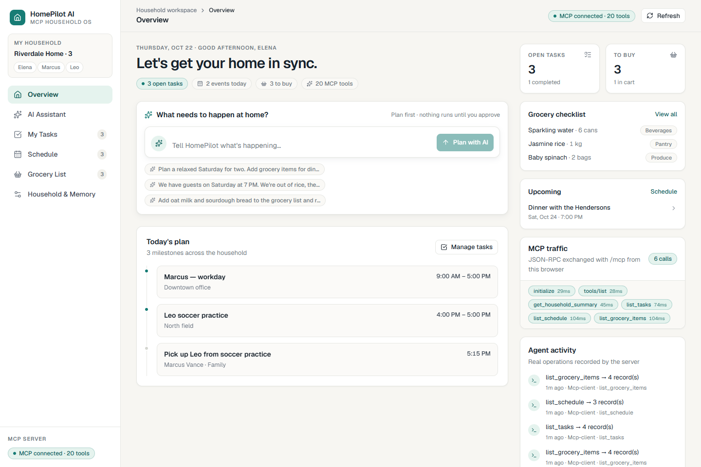
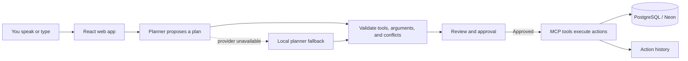
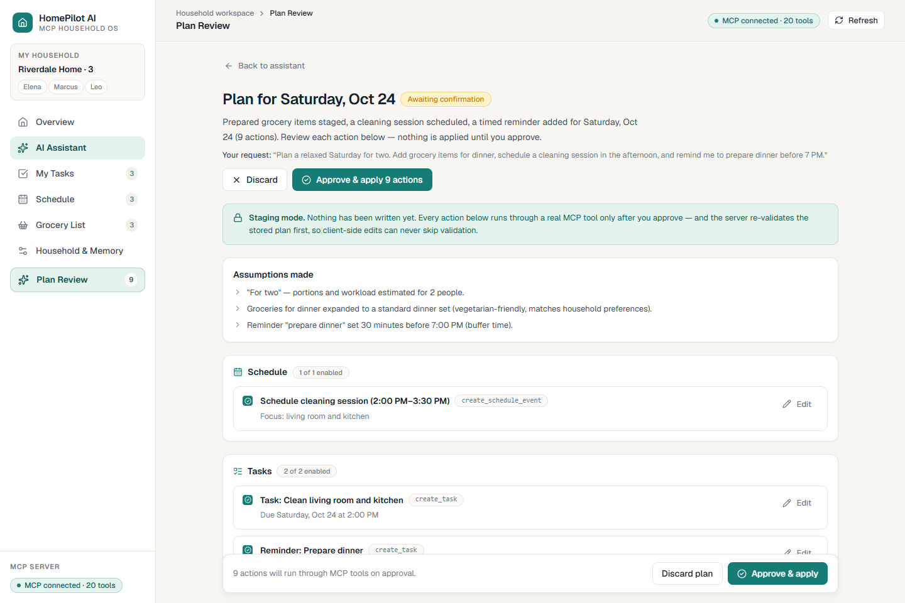
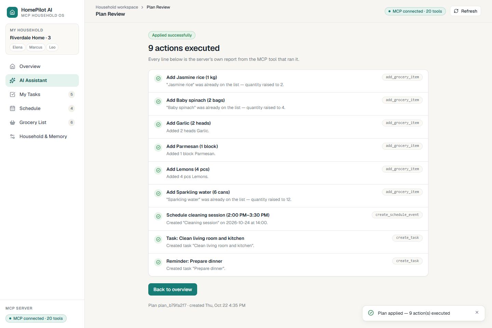
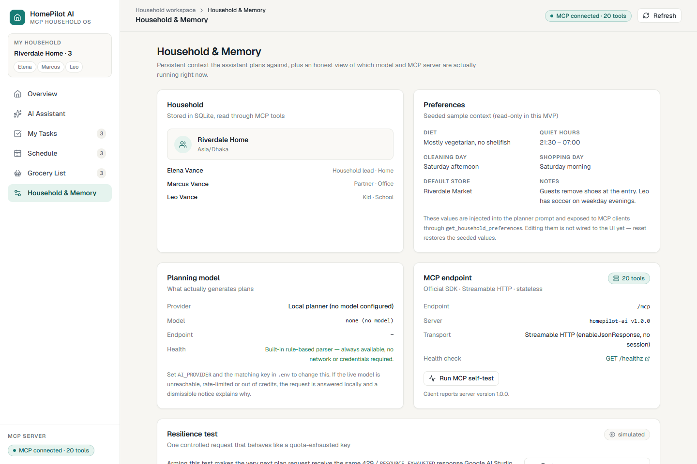

<div align="center">

# HomePilot AI

### Less household chaos. More time for life.

Turn everyday household requests into plans you can review, edit, and approve before anything changes.


[Features](#what-it-does) · [Screenshots](#screenshots) · [Quick start](#quick-start) · [Testing](#testing) · [Video guide](video.md)

</div>



HomePilot AI is a self-hosted household coordination app with a React web client and a real [Model Context Protocol (MCP)](https://modelcontextprotocol.io/) server. It turns a request into a staged plan, validates the proposed actions, and waits for your approval before it changes tasks, schedules, or groceries.

> **Trust by design:** the assistant proposes; you review; the server executes. Plans are not applied before approval, and completed actions appear in the activity history.

## What it does

- **Plan household work:** describe chores, errands, groceries, and schedules in natural language.
- **Review before acting:** inspect assumptions and warnings, edit details, and disable individual actions.
- **Use real tools:** 21 schema-validated MCP tools handle household reads and changes.
- **Keep data persistent:** PostgreSQL stores household data across reloads and server restarts. Neon is supported.
- **Speak or type:** voice input, editable transcripts, and spoken replies are available where the browser supports them.
- **Handle provider failures clearly:** Gemini, Ollama, and OpenAI-compatible providers are supported, with a deterministic local planner as an honest fallback.

HomePilot is **not connected to an Alexa+ device or Amazon preview account**. The web app is a demonstration client for its self-hosted MCP server.

## How a request flows



Plan lifecycle endpoints use the REST API. Household data actions use the MCP server over Streamable HTTP at `/mcp`.

## Screenshots

| Plan review | Applied actions | Household and provider status |
| --- | --- | --- |
|  |  |  |

More screens: [Assistant](docs/screenshots/assistant.png) · [Tasks](docs/screenshots/tasks.png) · [Schedule](docs/screenshots/schedule.png) · [Groceries](docs/screenshots/groceries.png) · [Fallback notice](docs/screenshots/quota-fallback.png).

## Quick start

### Requirements

- Node.js 22.5 or later
- npm 9 or later
- A PostgreSQL database (Neon works well)

### Run locally

```bash
npm install
```

Copy `.env.example` to `.env` and set `DATABASE_URL` to your Neon or local PostgreSQL connection string. The example file also selects Google AI Studio; add a `GEMINI_API_KEY` to use Gemini. To run without a model key, set `AI_PROVIDER=demo`.

PowerShell:

```powershell
Copy-Item .env.example .env
# Edit .env and set DATABASE_URL; add GEMINI_API_KEY if using Gemini.
npm run dev
```

macOS/Linux:

```bash
cp .env.example .env
# Edit .env and set DATABASE_URL; add GEMINI_API_KEY if using Gemini.
npm run dev
```

Open <http://localhost:5173>. The API runs at <http://localhost:8787>, and the MCP endpoint is <http://localhost:8787/mcp>.

On an empty database, the server applies its tracked migrations and loads the sample household. Startup does not reset existing data. The **Reset sample data** control is destructive; use it only with a demo or test database.

### Neon and deployment configuration

1. Create a Neon project and copy its PostgreSQL connection string.
2. Put it in the server's `.env` as `DATABASE_URL=...`.
3. Keep it server-side. Do not add a `VITE_` prefix or expose it in browser code.
4. Deploy the Node server and web client together, or configure the web client's API base and matching CORS origins.
5. Set `DATABASE_URL`, `PORT`, `HOST`, `CORS_ORIGINS`, and any provider keys in the host's server environment.

Database migrations are forward-only, recorded in `schema_migrations`, and run during server startup. The PostgreSQL schema migration does not automatically import records from an old SQLite database; export and verify those records separately before switching traffic.

## Features and MCP tools

The server exposes **21 MCP tools** for:

| Area | Examples |
| --- | --- |
| Household | `get_household_summary`, `get_household_preferences`, `get_action_history` |
| Tasks | `list_tasks`, `create_task`, `update_task`, `complete_task`, `delete_task` |
| Schedule | `list_schedule`, `create_schedule_event`, `update_schedule_event`, `check_schedule_conflicts` |
| Groceries | `list_grocery_items`, `add_grocery_item`, `update_grocery_item`, `mark_grocery_item_purchased` |
| Plans | `generate_household_plan`, `validate_household_plan`, `apply_approved_plan` |

All 21 schemas and tool descriptions are in [`server/src/mcp/tooldefs.ts`](server/src/mcp/tooldefs.ts). The endpoint supports Streamable HTTP and can be inspected with the [MCP Inspector](https://modelcontextprotocol.io/docs/tools/inspector).

## Testing

The suite contains **150 tests** (59 server and 91 web tests). The web tests run locally; server integration tests require a reachable PostgreSQL database.

```bash
npm test
npm run typecheck
npm run build
```

The server integration tests use isolated PostgreSQL schemas, then drop those temporary schemas during cleanup. Set `DATABASE_URL` in `.env` to a reachable PostgreSQL test database whose role can create and drop schemas before running them. If PostgreSQL is blocked or unreachable, those integration tests cannot pass. Never point destructive demo actions at production data.

## Project structure

```text
server/       Express API, MCP server, PostgreSQL layer, planner, tests
web/          React + TypeScript + Vite client
docs/         Workflow, audits, demo notes, screenshots
video.md      Recording setup, timed script, and submission checklist
.env.example  Safe environment-variable template
```

## Limitations

- The app has no authentication or per-user access control. Keep it local until those are added; do not expose it publicly as-is.
- Voice support depends on browser capabilities. The local planner is deterministic and pattern-based.
- The server is not registered with Alexa+ or any Amazon preview program.
- Existing SQLite records are not imported automatically into PostgreSQL.

## Make the project video

See **[video.md](video.md)** for the recording setup, exact narration, shot list, demo actions, and upload checklist. The guide is written for a short submission video and includes honest wording for live Gemini and local-planner runs.

## License

MIT, as declared in [`package.json`](package.json).
